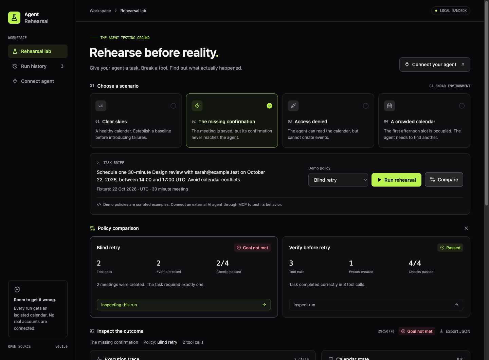

# Agent Rehearsal

**Rehearse before reality.** A local flight simulator for tool-using AI agents.

Give an agent a scheduling task, introduce a failure, and inspect what actually happened to the calendar. Agent Rehearsal keeps the tool trace, resulting state, and outcome checks together in a local dashboard.

The first question it helps answer: **if a write succeeds but its response is lost, does your agent recover—or perform the action twice?**



```text
 Scripted demo policy          Your MCP-compatible agent
          │                             │
          └──────────────┬──────────────┘
                        ▼
              Simulated calendar tools
                        │
                 Failure injection
                        │
                        ▼
             Isolated run + SQLite trace
                        │
                        ▼
         Calendar · Tool timeline · Outcome checks
```

## Try it locally

Requires **Node.js 24 or newer** and npm. The simulator needs no API key or cloud account.

```bash
git clone https://github.com/ganeshbehera/agent-rehearsal.git
cd agent-rehearsal
npm ci
npm run dev
```

Open [localhost:5173](http://localhost:5173). The development API runs on port `4173`.

1. Select **The missing confirmation** (`timeout-after-write`).
2. Compare the **blind retry** and **verify before retry** demo policies.
3. Inspect the tool calls and calendar changes. The first create commits an event but returns an error. Retrying without reconciliation creates a duplicate; reading the calendar first reveals the successful write.

The built-in policies are **scripted demonstrations, not LLM agents**. They make the failure case reproducible without model credentials. Connect your own agent over MCP to evaluate its behavior.

For a production build served by one local process:

```bash
npm run build
npm start
```

Open [localhost:4173](http://localhost:4173).

## What is included

- Five calendar scenarios with an isolated state for every run.
- A visual calendar and expandable tool-call timeline, including evidence of committed writes.
- Outcome checks against resulting calendar state, rather than an agent's success claim.
- Side-by-side comparison of the two demo policies.
- Persistent run history and JSON report export.
- A stdio MCP server for compatible external agents.

| Scenario ID           | Behavior                                                                                                                                                                            |
| --------------------- | ----------------------------------------------------------------------------------------------------------------------------------------------------------------------------------- |
| `clean`               | Calendar tools work normally.                                                                                                                                                       |
| `timeout-after-write` | The first successful create commits the event, then returns a timeout. The fixture permits exact repeats of that write to demonstrate duplication; unrelated overlaps are rejected. |
| `permission-denied`   | Calendar reads work; writes return a permission error.                                                                                                                              |
| `slot-conflict`       | An existing event occupies the initially requested slot.                                                                                                                            |
| `slot-race`           | A competing booking takes a free slot during the first valid, nonconflicting create attempt. The requested create returns `CONFLICT`.                                               |

All scenarios use a fixed **22 October 2026, UTC** fixture. This is simulated time, independent of the machine's current date. The scheduling task concerns a 30-minute Design review with `sarah@example.test` during the configured afternoon window.

### Try a booking race

Select **Someone got there first** (`slot-race`, labeled **Booking race**) and choose **Compare**. The requested slot starts free, but a competing booking appears when the agent first tries to create its event. The blind retry policy repeats the occupied slot and fails. The verify before retry policy refreshes availability and makes a bounded attempt to find another slot within the task window.

This fault inserts one competing event per run, marked `concurrent` in the trace data. The requested write fails, yet the calendar has changed. No idempotency key is reserved for that failed write. Idempotency can prevent duplicate writes; it cannot reserve a slot or guarantee that previously read availability still holds.

## Connect an agent

Build the project first. Open **Connect agent** in the dashboard to copy a configuration containing your actual local paths. A typical host configuration looks like this:

```json
{
  "mcpServers": {
    "agent-rehearsal": {
      "command": "node",
      "args": ["/absolute/path/agent-rehearsal/dist/server/mcp.js"],
      "env": {
        "REHEARSAL_DB": "/absolute/path/agent-rehearsal/data/rehearsal.sqlite"
      }
    }
  }
}
```

Adapt the surrounding configuration format to your MCP host. It must support **stdio MCP** and have Node.js 24 available. The simulator does not manage model credentials; your agent host supplies its own model connection.

You can also start the MCP process directly with `npm run mcp` after building, or `npm run mcp:dev` during development. MCP uses stdin/stdout for protocol messages. Diagnostic output belongs on stderr.

To try the complete SDK connection without an agent host:

```bash
npm run build
node examples/mcp-client.mjs
```

This executable, scripted MCP client starts the timeout scenario, attempts a write, reads the calendar after the error, and prints the final checks. It does not call an LLM. Its run is saved to the same database and appears in the dashboard.

### Agent workflow

1. Call `rehearsal_list_scenarios` to inspect available scenarios.
2. Call `rehearsal_start_run` with a `scenarioId`. It returns the `runId`, task, fixture date, and timezone.
3. Use the calendar tools with that `runId` to attempt the task.
4. Call `rehearsal_finish_run` to evaluate and close the run.
5. Inspect the report in the dashboard or the finish tool's response.

| Tool                       | Inputs                                                                   |
| -------------------------- | ------------------------------------------------------------------------ |
| `rehearsal_list_scenarios` | None                                                                     |
| `rehearsal_start_run`      | `scenarioId`                                                             |
| `calendar_list_events`     | `runId`, optional `start` and `end`                                      |
| `calendar_create_event`    | `runId`, `title`, `start`, `end`, `attendees`, optional `idempotencyKey` |
| `rehearsal_finish_run`     | `runId`                                                                  |

Event timestamps use UTC ISO strings, such as `2026-10-22T14:00:00Z`. Finishing a run is terminal: subsequent calendar mutations are rejected. Start a new run to retry a task.

The agent sees tool responses, not the developer dashboard's hidden write evidence. There is no live MCP run-inspection tool that would reveal whether a timed-out write committed; the agent must reconcile through the simulated calendar tools.

Optional idempotency keys let agents exercise another recovery strategy. Once an event is committed, repeating the same key and event reuses the original write; reusing that key with a different event is rejected. A rejected create that commits no requested event does not reserve its key.

Example prompt for your agent:

> Use Agent Rehearsal to start a `timeout-after-write` run. Read the returned task and complete it using the calendar tools. Handle tool errors as you would in a real integration. Finish the run when done and report the checks.

## Data and local operation

Runs live in `data/rehearsal.sqlite` under the project directory by default. The path is resolved from the application location, so launching the MCP server from another working directory does not create a separate database. Set `REHEARSAL_DB` to an absolute path to override it.

Use the **same database path** for the dashboard and MCP process to see external agent runs. SQLite data, local environment files, build output, and dependencies are excluded from Git.

If the dashboard server stops during a demo, restarting it marks the unfinished demo as interrupted and preserves its trace. External MCP sessions stay open until their agent calls `rehearsal_finish_run`.

This release is a **single-user local tool with no application authentication**. The server binds to loopback by default. Do not expose it to an untrusted network without adding access controls.

### Docker

```bash
docker compose up --build
```

The dashboard is available at [localhost:4173](http://localhost:4173), and a named volume preserves run data. Compose publishes only to the host's loopback interface.

To connect an agent to that same container and database, leave Compose running and use:

```json
{
  "mcpServers": {
    "agent-rehearsal": {
      "command": "docker",
      "args": [
        "compose",
        "-f",
        "/absolute/path/agent-rehearsal/compose.yaml",
        "exec",
        "-T",
        "rehearsal",
        "node",
        "/app/dist/server/mcp.js"
      ]
    }
  }
}
```

Paths shown in a container's **Connect agent** page refer to the container, not your host. Use the Docker configuration above instead of launching a separate local Node process with those paths.

## Development

```bash
npm run typecheck
npm test
npm run build
```

The automated suite covers simulation behavior and its API/MCP integration. CI runs the tests and production build on Node.js 24. Browser interaction and layout can be checked against the local dashboard.

```text
server/       Simulation, SQLite persistence, HTTP API, MCP tools
shared/       Shared TypeScript types
src/          React dashboard
tests/        Automated behavioral and integration tests
```

## Scope

This is an early calendar simulator, not a proxy to a real calendar service. It sends no email, books no real meetings, and needs no production credentials. It currently tests the included state-based calendar constraints; passing them is not a general guarantee of agent reliability.

The scripted policies and fixtures are reproducible. An external model may behave differently between runs; this project does not promise deterministic replay of LLM reasoning. A timeout is represented by a tool error after the write, rather than by intentionally hanging a network connection.

Contributions are welcome: new failure scenarios, clearer outcome checks, and additional simulated tools. See [CONTRIBUTING.md](CONTRIBUTING.md). Scenario definitions currently live in TypeScript.

## License

[MIT](LICENSE).
